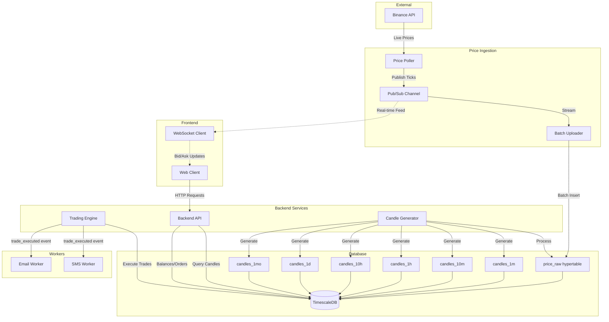
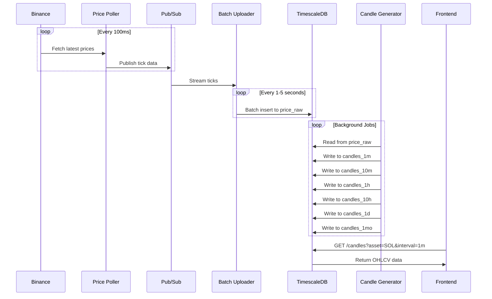
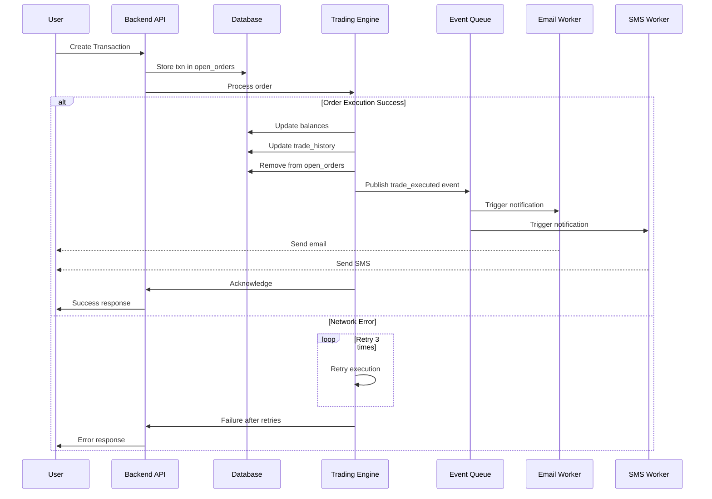

# 📈 Exness-Style Trading System

> A simplified, educational clone of the Exness backend architecture implementing a full trading pipeline with real-time price streaming, multi-interval candlestick generation, and order management.


## 📑 Table of Contents

- [Overview](#overview)
- [Architecture](#architecture)
- [System Flow](#system-flow)
- [Features](#features)
- [Database Schema](#database-schema)
- [Getting Started](#getting-started)
- [API Endpoints](#api-endpoints)
- [Configuration](#configuration)
- [Development](#development)
- [Roadmap](#roadmap)

---

## 🎯 Overview

This project demonstrates a production-grade trading backend architecture featuring:

* **Real-time price streaming** from Binance
* **Multi-interval candlestick generation** (1m, 10m, 1h, 10h, 1d, 1mo)
* **Order management** system (limit, market, stop orders)
* **Trade execution engine** with retry logic
* **Event-driven workers** for notifications
* **TimescaleDB-powered** time-series data storage
* **RESTful APIs** for frontend integration

---

## 🏗️ Architecture

### High-Level System Architecture



---

## 🔄 System Flow

### Price Data Pipeline



### Trade Execution Flow



---

## ✨ Features

### Current Implementation

- ✅ **Real-time Price Ingestion**: Continuous streaming from Binance API
- ✅ **Pub/Sub Architecture**: Decoupled components using message queues
- ✅ **TimescaleDB Integration**: Optimized time-series data storage
- ✅ **Multi-Interval Candles**: Automatic generation of 6 timeframes
- ✅ **Batch Processing**: Efficient bulk inserts for high-throughput

### In Progress

- 🚧 **Frontend Chart Integration**: Real-time candlestick charts
- 🚧 **Order Management UI**: Visual order placement and tracking
- 🚧 **Balance Dashboard**: Real-time portfolio overview

---

## 🗄️ Database Schema

### TimescaleDB Hypertables

| Table         | Interval  | Purpose                      | Retention |
|---------------|-----------|------------------------------|-----------|
| `price_raw`   | -         | Raw tick data from Binance   | 7 days    |
| `candles_1m`  | 1 minute  | 1-minute OHLCV candles      | 30 days   |
| `candles_10m` | 10 minutes| 10-minute OHLCV candles     | 90 days   |
| `candles_1h`  | 1 hour    | 1-hour OHLCV candles        | 1 year    |
| `candles_10h` | 10 hours  | 10-hour OHLCV candles       | 2 years   |
| `candles_1d`  | 1 day     | Daily OHLCV candles         | 5 years   |
| `candles_1mo` | 1 month   | Monthly OHLCV candles       | Forever   |

### Core Tables

| Table           | Purpose                                        |
|-----------------|------------------------------------------------|
| `users`         | User accounts and authentication               |
| `assets`        | Supported trading assets (BTC, ETH, SOL, etc.) |
| `balances`      | User wallet balances per asset                 |
| `open_orders`   | Active orders awaiting execution               |
| `trade_history` | Completed trade records                        |

### Example Schema

```sql
-- Hypertable for raw price data
CREATE TABLE price_raw (
    time TIMESTAMPTZ NOT NULL,
    asset_id INT NOT NULL,
    bid DECIMAL(18, 8) NOT NULL,
    ask DECIMAL(18, 8) NOT NULL,
    volume DECIMAL(18, 8)
);

SELECT create_hypertable('price_raw', 'time');

-- Hypertable for 1-minute candles
CREATE TABLE candles_1m (
    time TIMESTAMPTZ NOT NULL,
    asset_id INT NOT NULL,
    open DECIMAL(18, 8) NOT NULL,
    high DECIMAL(18, 8) NOT NULL,
    low DECIMAL(18, 8) NOT NULL,
    close DECIMAL(18, 8) NOT NULL,
    volume DECIMAL(18, 8) NOT NULL
);

SELECT create_hypertable('candles_1m', 'time');
```

---

## 🚀 Getting Started

### Prerequisites

- Node.js >= 18.x
- Docker & Docker Compose
- TimescaleDB >= 2.11
- Redis >= 7.0

### Installation

1. **Clone the repository**
   ```bash
   git clone https://github.com/yourusername/exness-trading-system.git
   cd exness-trading-system
   ```

2. **Install dependencies**
   ```bash
   npm install
   ```

3. **Set up environment variables**
   ```bash
   cp .env.example .env
   # Edit .env with your configuration
   ```

4. **Start infrastructure with Docker**
   ```bash
   docker-compose up -d
   ```

5. **Run database migrations**
   ```bash
   npm run migrate
   ```

6. **Start the application**
   ```bash
   npm run dev
   ```

---

## 🔌 API Endpoints

### Candles API

```http
GET /api/candles?asset=SOL&interval=1m&from=2024-01-01&to=2024-01-31
```

**Response:**
```json
{
  "asset": "SOL",
  "interval": "1m",
  "data": [
    {
      "time": "2024-01-01T00:00:00Z",
      "open": 98.50,
      "high": 99.00,
      "low": 98.20,
      "close": 98.80,
      "volume": 15420.50
    }
  ]
}
```

### Orders API

```http
POST /api/orders
Content-Type: application/json

{
  "asset_id": 1,
  "type": "limit",
  "side": "buy",
  "price": 98.50,
  "quantity": 10
}
```

### Balances API

```http
GET /api/balances
```

---

## ⚙️ Configuration

### Environment Variables

```env
# Database
TIMESCALE_HOST=localhost
TIMESCALE_PORT=5432
TIMESCALE_DB=trading_db
TIMESCALE_USER=postgres
TIMESCALE_PASSWORD=yourpassword

# Redis
REDIS_HOST=localhost
REDIS_PORT=6379

# Binance API
BINANCE_API_KEY=your_api_key
BINANCE_API_SECRET=your_api_secret

# Workers
EMAIL_SERVICE=smtp.gmail.com
SMS_SERVICE=twilio

# Application
NODE_ENV=development
PORT=3000
LOG_LEVEL=info
```

---

## 💻 Development

### Project Structure

```
.
├── src/
│   ├── services/
│   │   ├── price-poller.ts      # Binance price fetching
│   │   ├── batch-uploader.ts    # Bulk data insertion
│   │   ├── candle-generator.ts  # OHLCV calculation
│   │   └── trading-engine.ts    # Order execution
│   ├── workers/
│   │   ├── email-worker.ts      # Email notifications
│   │   └── sms-worker.ts        # SMS notifications
│   ├── api/
│   │   ├── routes/              # API route handlers
│   │   └── middleware/          # Express middleware
│   ├── db/
│   │   ├── models/              # Database models
│   │   └── migrations/          # SQL migrations
│   └── utils/
│       ├── pubsub.ts            # Pub/Sub implementation
│       └── logger.ts            # Logging utility
├── docker-compose.yml
├── package.json
└── README.md
```

### Running Tests

```bash
npm test                 # Run all tests
npm run test:unit       # Unit tests only
npm run test:integration # Integration tests
```

### Code Quality

```bash
npm run lint            # ESLint
npm run format          # Prettier
npm run type-check      # TypeScript
```

---

## 🗺️ Roadmap

### Phase 1: Core Infrastructure ✅
- [x] Price polling from Binance
- [x] Pub/Sub pipeline
- [x] TimescaleDB integration
- [x] Batch uploader
- [x] Multi-interval candle generation

### Phase 2: Trading Engine (Current)
- [x] Order creation and storage
- [x] Basic trade execution
- [ ] Advanced order types (stop-loss, take-profit)
- [ ] Order matching engine
- [ ] Risk management system

### Phase 3: Frontend Integration
- [ ] Real-time WebSocket feeds
- [ ] Candlestick chart component
- [ ] Order placement UI
- [ ] Portfolio dashboard
- [ ] Trade history view

### Phase 4: Advanced Features
- [ ] Multi-asset support (100+ assets)
- [ ] Margin trading simulation
- [ ] Portfolio analytics
- [ ] Backtesting engine
- [ ] API rate limiting and caching

---

## 📄 License

This project is licensed under the MIT License - see the [LICENSE](LICENSE) file for details.

---

## 🤝 Contributing

Contributions are welcome! Please read [CONTRIBUTING.md](CONTRIBUTING.md) for details on our code of conduct and the process for submitting pull requests.

---

## 📧 Contact

For questions or support, please open an issue on GitHub.

---

**⚠️ Disclaimer**: This is an educational project. Do not use in production for real trading without proper security audits, risk management, and regulatory compliance.
